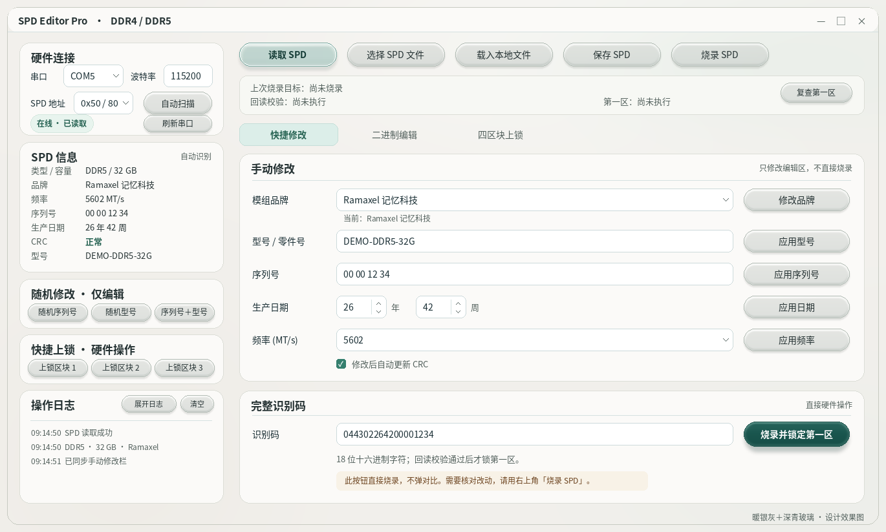
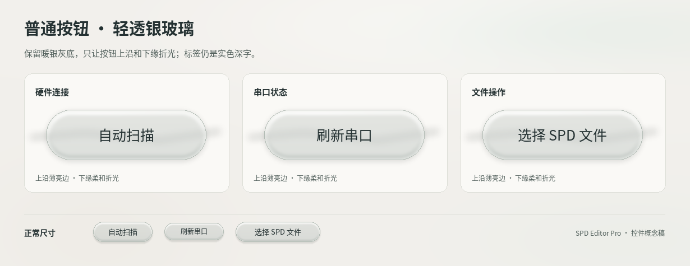

# SPD Editor Pro

面向 DDR4 / DDR5 SPD 烧录器的中文图形化工具。支持 SPD 读取、增量烧录、二进制编辑、CRC 校验与修复、模组品牌与序列号编辑、分区写保护。

> 本仓库仅发布 Windows 便携包，不公开应用源码。请仅操作自己拥有或获准维护的内存。

> **v3.1.0 启动提示：** 有用户反馈打开后窗口持续刷新、不显示界面。若遇到此问题，请关闭新版，暂用[上一版便携包](https://github.com/Qeao-zl/SPD-Editor-Pro/releases/tag/v2.9.3-fast-three-lock)，不要在异常窗口中执行烧录。

## 下载 v3.1.0

- [下载 Windows x64 便携包](https://github.com/Qeao-zl/SPD-Editor-Pro/releases/download/v3.1.0/SPD_Editor_Pro_v3.1.0.zip)
- [发布说明和 SHA-256 校验](https://github.com/Qeao-zl/SPD-Editor-Pro/releases/tag/v3.1.0)

### 新版界面

暖银灰工作区。普通操作采用浅银玻璃按钮，读取按钮使用浅青玻璃，「烧录并锁定第一区」采用深青玻璃。快捷修改页将手动修改与完整识别码分区；二进制编辑、四区块上锁仍保留原布局。

下图是按本版界面绘制的设计示意，使用模拟数据，并非 Windows 实机截图。

### 使用方法

1. 完整解压到新文件夹，双击根目录的 `【双击启动】SPD Editor Pro.exe`。不要移动「程序文件」目录。
2. 接上烧录器，点击「读取 SPD」。直读失败会在当前串口自动扫描并重试。手动修改栏同步新读取的数据。先保存原始 SPD 备份。
3. 普通编辑先应用各项更改。右上角「烧录 SPD」会列出待写字段的原值和新值，确认后才烧录，本次不锁。
4. 「烧录并锁定第一区」直接执行，不弹对比；逐字节回读校验通过后才锁第一区。读取时不会自动做原值写回验锁；如需检测现有锁状态，请在「四区块上锁」手动操作。

内置 2,306 条 JEDEC 厂商识别记录，与 28 个编辑预设分开。DDR5 容量若料号未包含容量不一定能识别；显示的速率取自 SPD 时序，不是机器当前运行速率。

本版完成 Windows 目标编译和离线测试，未验证真实烧录器或 Windows 实机。建议先用备份文件离线试用。

## 历史版本

- [v2.9.3 高速烧录・三区快捷上锁・舒适字体版](https://github.com/Qeao-zl/SPD-Editor-Pro/releases/tag/v2.9.3-fast-three-lock)
- [v2.9.3 横屏与厂商识别预览](https://github.com/Qeao-zl/SPD-Editor-Pro/releases/tag/v2.9.3-preview.1)
- [全部历史版本](https://github.com/Qeao-zl/SPD-Editor-Pro/releases)

## 运行要求

- Windows 10 / Windows 11 64 位；
- SPDRW 兼容烧录器；
- 烧录器对应的 USB 串口驱动，例如 CH340 驱动；
- 部分 DDR4 写保护操作需要烧录器具备正常的 9V 高压线路。

便携包已包含 .NET 运行环境，无需另外安装 .NET。

## 安全说明

- 烧录前务必保存原始 SPD 备份；
- 不要在写入或上锁过程中拔出烧录器或内存条；
- 修改关键时序、容量或组织结构字段可能导致设备无法启动；
- “强制写入”只应在确认镜像正确且普通写入失败时使用；
- 软件显示的上锁状态会结合硬件状态查询和原值写回检测进行判断。

## 历史版本校验

| 版本 | SHA256 |
| --- | --- |
| 高速烧录・三区快捷上锁・舒适字体版 | `B805259BD152C5C737A8A3B7912652C2ACBF732104EE14B916B21818C49F3392` |
| 高速烧录・两步工作流版 | `C62465D9BC440C7ABDEEA353B701912F5CB1767BFFD66B5C6AB7C3E1414D0AB5` |
| 四区一致自动验锁版 | `5451B0AEBC8111223E750B78632C968765C1BF68A39DFB36161F5EB42A3E8B50` |
| 批量自动验锁版 | `5E4324929AED0E40B487CB77935D2D1E53BF0CCE3509E773779750CAC6669A74` |

## 第三方组件

便携包包含 SPDRW 读写组件。SPDRW 相关程序版权归其原作者 A213M 所有，本项目不声明对第三方组件的所有权。

