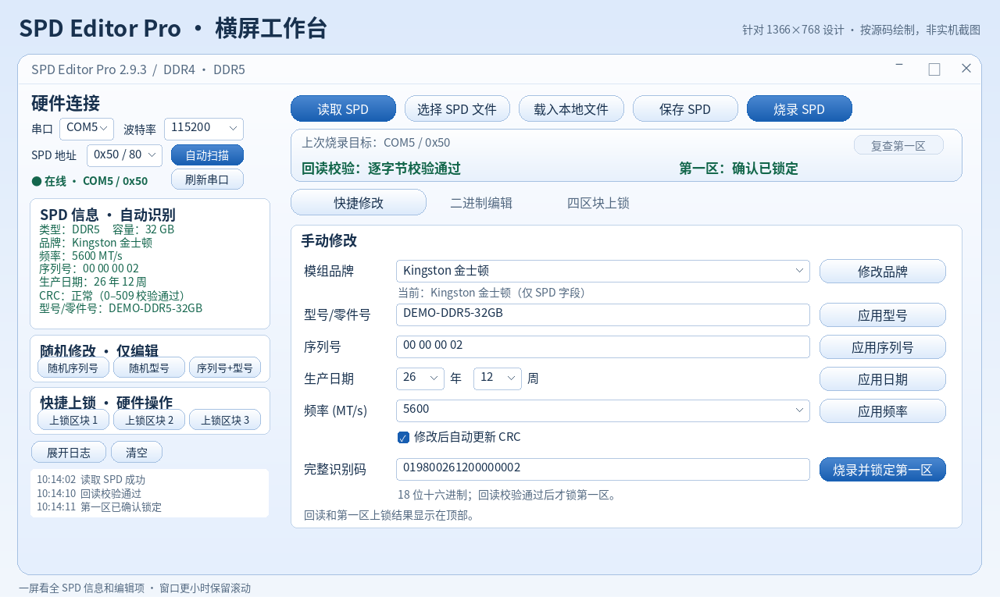
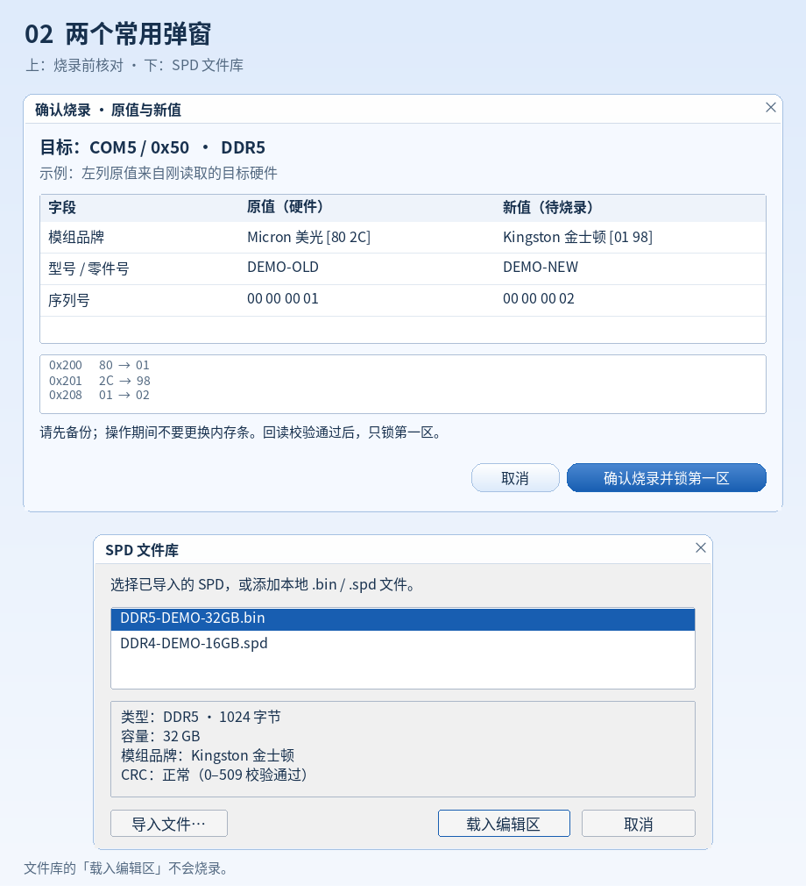

# SPD Editor Pro

面向 DDR4 / DDR5 SPD 烧录器的中文图形化编辑工具，支持 SPD 读取、增量烧录、二进制编辑、CRC 校验与修复、序列号/生产日期/频率快捷修改，以及分区写保护状态检测。

> 本仓库用于发布 Windows 便携版本，不公开应用源码。请仅对自己拥有或获准维护的内存条进行操作。

## v2.9.3 横屏与厂商识别预览

- 横屏工作台同时显示 SPD 详情和快捷修改，操作日志可向下展开。
- 内置 2,306 个 JEDEC 厂商识别条目。识别库和可选的品牌修改预设分开；厂商编码校验异常时会明确提示。
- SPD 文件库可导入并预览 `.bin` / `.spd`，加载到编辑区不会直接烧录。
- 使用「烧录并锁定第一区」时，先对照原值和新值，写入并逐字节回读通过后才锁第一区。

> 预览版已做离线测试，尚未完成 Windows 和实物烧录验证。DDR5 容量目前只从料号中的容量字样提取，速率来自 SPD 时序，不是机器实际运行速率。建议先用备份文件离线试用。

### 界面展示

下图按本版布局绘制，使用模拟数据，并非 Windows 实机截图。

## 推荐版本

推荐下载 **高速烧录・三区快捷上锁・舒适字体版**。它包含目前完整且稳定的功能：

- 输入完整识别码后，一键“修改并烧录”；
- 只写发生变化的数据页，并在同一串口会话中回读校验；
- 快捷修改页提供“上锁区块1 / 2 / 3”；
- 自动检测 CRC、提示二进制改动；
- 更换内存条后自动清除上一根的锁状态；
- 窗口模式、最大化和不同分辨率适配；
- 自带 .NET 运行环境，解压后可以直接运行。

[下载推荐版本](https://github.com/Qeao-zl/SPD-Editor-Pro/releases/tag/v2.9.3-fast-three-lock)

## 最近版本

| 版本 | 适用场景 | 下载 |
| --- | --- | --- |
| 高速烧录・三区快捷上锁・舒适字体版 | 日常批量生产，推荐 | [v2.9.3-fast-three-lock](https://github.com/Qeao-zl/SPD-Editor-Pro/releases/tag/v2.9.3-fast-three-lock) |
| 高速烧录・两步工作流版 | 修改完整识别码后锁定区块1 | [v2.9.3-fast-two-step](https://github.com/Qeao-zl/SPD-Editor-Pro/releases/tag/v2.9.3-fast-two-step) |
| 四区一致自动验锁版 | 重点验证四个区块 | [v2.9.3-four-region](https://github.com/Qeao-zl/SPD-Editor-Pro/releases/tag/v2.9.3-four-region) |
| 批量自动验锁版 | 基础批量读取与自动验锁 | [v2.9.3-batch-auto-lock](https://github.com/Qeao-zl/SPD-Editor-Pro/releases/tag/v2.9.3-batch-auto-lock) |

## 使用方法

1. 从 Releases 下载所需 ZIP。
2. 将 ZIP **完整解压**到普通文件夹，不能直接在压缩软件预览窗口中运行。
3. 双击根目录中的 `【双击启动】SPD Editor Pro.exe`。
4. 连接烧录器并点击“自动扫描”或“读取 SPD”。
5. 首次操作任何内存条时，先保存原始 SPD 备份。

推荐批量流程：

1. 插入内存条并读取 SPD；
2. 输入完整识别码，点击“修改并烧录”；
3. 烧录成功后，根据需要点击“上锁区块1”“上锁区块2”或“上锁区块3”；
4. 确认日志显示上锁成功后，再更换下一根。

## 运行要求

- Windows 10 / Windows 11 64 位；
- SPDRW 兼容烧录器；
- 烧录器对应的 USB 串口驱动，例如 CH340 驱动；
- 部分 DDR4 写保护操作需要烧录器具备正常的 9V 高压线路。

便携包已包含 .NET 运行环境，无需另外安装 .NET。

## 安全说明

- 烧录前务必保存原始 SPD 备份；
- 不要在写入或上锁过程中拔出烧录器或内存条；
- 修改关键时序、容量或组织结构字段可能导致设备无法启动；
- “强制写入”只应在确认镜像正确且普通写入失败时使用；
- 软件显示的上锁状态会结合硬件状态查询和原值写回检测进行判断。

## 文件校验

| 版本 | SHA256 |
| --- | --- |
| 高速烧录・三区快捷上锁・舒适字体版 | `B805259BD152C5C737A8A3B7912652C2ACBF732104EE14B916B21818C49F3392` |
| 高速烧录・两步工作流版 | `C62465D9BC440C7ABDEEA353B701912F5CB1767BFFD66B5C6AB7C3E1414D0AB5` |
| 四区一致自动验锁版 | `5451B0AEBC8111223E750B78632C968765C1BF68A39DFB36161F5EB42A3E8B50` |
| 批量自动验锁版 | `5E4324929AED0E40B487CB77935D2D1E53BF0CCE3509E773779750CAC6669A74` |

## 第三方组件

便携包包含 SPDRW 读写组件。SPDRW 相关程序版权归其原作者 A213M 所有，本项目不声明对第三方组件的所有权。

